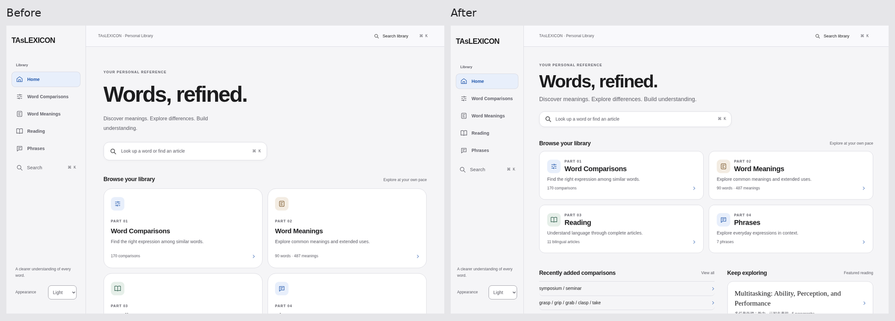
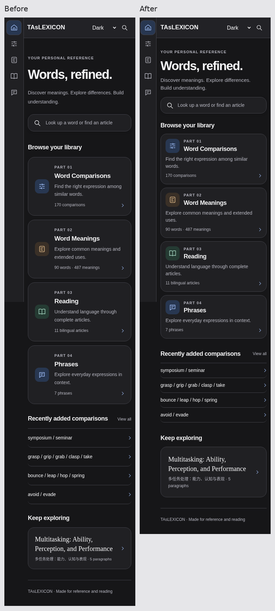

# TAsLEXICON 首页比例验收

**CONDITIONAL PASS** · 候选分支 `design/homepage-proportions-20261120`，开发基点 `bd196a6a7889b745eb3b2fa6d3786657045a867f`。在 iPhone 与 Mac Safari 人工确认后可合并。候选分支只运行验证工作流，生产工作流监听 main。

## 同条件视觉对照

以下缩略图均为左侧原版、右侧候选版。表中的链接打开对应分辨率的原始 PNG。截图使用相同内容、相同 Chromium、DPR 1、页面原点和显式主题。卡片、下方区域从整页截图按 DOM 边界裁切，两版均未滚动定位。完整页面中固定侧栏与顶栏只在视口原位绘制一次。





| 视口、主题 | 完整页面 | 首屏 | 四个分类 | 最近更新与精选阅读 |
|---|---|---|---|---|
| 1366×900 浅色 | [原图](before/1366-light-full.png) / [候选](after/1366-light-full.png) | [原图](before/1366-light-viewport.png) / [候选](after/1366-light-viewport.png) | [原图](before/1366-light-cards.png) / [候选](after/1366-light-cards.png) | [原图](before/1366-light-lower.png) / [候选](after/1366-light-lower.png) |
| 1366×900 深色 | [原图](before/1366-dark-full.png) / [候选](after/1366-dark-full.png) | [原图](before/1366-dark-viewport.png) / [候选](after/1366-dark-viewport.png) | [原图](before/1366-dark-cards.png) / [候选](after/1366-dark-cards.png) | [原图](before/1366-dark-lower.png) / [候选](after/1366-dark-lower.png) |
| 390×844 浅色 | [原图](before/390-light-full.png) / [候选](after/390-light-full.png) | [原图](before/390-light-viewport.png) / [候选](after/390-light-viewport.png) | [原图](before/390-light-cards.png) / [候选](after/390-light-cards.png) | [原图](before/390-light-lower.png) / [候选](after/390-light-lower.png) |
| 390×844 深色 | [原图](before/390-dark-full.png) / [候选](after/390-dark-full.png) | [原图](before/390-dark-viewport.png) / [候选](after/390-dark-viewport.png) | [原图](before/390-dark-cards.png) / [候选](after/390-dark-cards.png) | [原图](before/390-dark-lower.png) / [候选](after/390-dark-lower.png) |

## 布局实测

单位均为 CSS px。卡片高度取第一张，纵坐标从页面顶部计算，正文宽度取分类网格的内容框。下表为 Chromium 浅色结果。原始数据包含两种主题、元素坐标与每张卡片的宽高。

| 项目 | 原版 | 候选 |
|---|---:|---:|
| 1366×900 标题 / 搜索宽 | 68 / 510 | 56 / 600 |
| 1366×900 Hero 高度 | 367.5 | 250.7 |
| 1366×900 卡片宽 × 高 | 496.4 × 249 | 513 × 151.7 |
| 1366×900 分类网格高度 | 514.1 | 319.4 |
| 1366×900 下方模块起点 | 1065.3 | 751.5 |
| 1366×900 最近更新 / 精选阅读宽度 | 488.4 / 488.4 | 546.5 / 455.5 |
| 1728×1117 正文宽度 | 1072 | 1056 |
| 390×844 标题 / 卡片内边距 | 38 / 20 | 37.14 / 14 |
| 390×844 分类网格高度 | 732.9 | 608.2 |
| 320×568 侧栏 / 正文宽度 | 58 / 234 | 50 / 246 |
| 760→761 侧栏宽度 | 58→220 | 50→51 |
| 760→761 正文宽度 | 678→480.1 | 657.2→657.1 |

[Chromium 基线](before/measurements.json) · [Chromium 候选](after/measurements.json) · [Linux WebKit 候选](webkit/measurements.json) · [回归结果](regression.json)

### 设计与复审

- 桌面原版标题与搜索框之间的说明文字提前换行。候选版将副标题与搜索框放在同一条最大 600px 的文本轴上。1366px 宽屏副标题用一行，390px 手机保留两行。
- 四张卡片复用相同结构。图标与编号、标题组成一组，说明和数量可以使用整行。手机卡片内边距 14px，桌面最大 24px。卡片依据文字排版决定高度。正文达到 600px 才并排两张，因此在侧栏展开、旋转和浏览器缩放后仍按实际可用宽度排版。
- 桌面原版四行最近更新高 225px，右侧精选卡高约 135px。候选版使用 1.2∶1 双栏并将列表行收至至少 44px，四行总高约 177px。精选文章保留完整标题和元信息。正文不足 660px 时自然依次排布。
- 顶栏、标题、搜索、分类与下方模块共用可用内容框的起点。正文左右边距从 12px 流动到 48px，剩余空间用于居中。侧栏在 900px、1024px、1366px 分别约 170px、182px、228px。左右安全区按 CSS 环境变量参与计算。
- 第一版横屏分类入口仍偏低，中等宽度的图标栏在接近桌面模式时已有足够空间放文字。复审后收紧短横屏 Hero，并在 870px 的普通高度视口显示文字导航。将原手机阅读目录的断点样式限定到目录，把页脚留白改成连续变化。760px 与 761px 的候选整页均高 1179px。横屏 844×390 的分类区从基线 y=431 提前到 y=305。
- 对比 12 个生成页面，移除样式表版本参数后逐字节相同，1233 个 ID 与顺序相同。所有 JavaScript、学习资料与 6 个生成 JSON 均与开发基点一致。文章的独立阅读宽度及词典定位继续使用原有机制。

## 验证范围

- Chromium 156.0.8078.79 和 Linux Playwright WebKit 26.5 均检查了 320×568、375×667、390×844、430×932、760×800、761×800、844×390、900×800、1024×768、1366×900、1728×1117 的显式浅色与深色。候选版每引擎 22 组，页面横向溢出、过小的可见首页交互目标、首页控制台错误均为 0。两引擎还在同一打开的页面各调整 112 个宽度，并验证系统明暗切换、主题持久化、键盘展开导航与搜索关闭后的焦点恢复。
- 项目门禁 23 项命令及 3 项完整性检查全部通过，包含构建、干净目录重建、资源版本、路由、所有阅读原文与译文、对比度、搜索以及语音控制器。Pages 子路径本地模拟的 23 个实际响应和候选 dist 字节相同。
- Chromium 移动回归 84 组 / 1104 项，阅读器 90 组 / 332 项，全站 90 组 / 11451 项通过。全站包含 534 次折叠操作、132 次文章视图及 2448 次查词。跨功能测试 8/8，覆盖录音与回放、搜索、词典、历史恢复和注入左右 44px 安全区的横屏。录音测试使用合成输入流。
- 首轮并行测试读取了构建过程中的临时 dist，产生了阅读页初始化失败。正式结果在构建结束后重新采集，三套页面回归均使用独立静态副本。
- 真机待验：iPhone Safari 地址栏和软键盘升降、刘海/横屏旋转、系统字号与 VoiceOver 焦点和阅读顺序、真人录音权限和扬声器回放，以及 Mac Safari 的系统字体及键盘浏览。Linux WebKit 使用桌面字体和模拟视口。

## 文件与复现

| 路径 | 修改范围 |
|---|---|
| `content/search.css` | 共享外壳布局、首页组件、容器断点，清理叠加的桌面和手机规则 |
| `dist/search.css` | 生成样式 |
| `dist/*.html`（12 个） | index、business-travel-airfares、busyness-as-status、hobbies-and-work、how-to-fix-the-internet、motherhood、multitasking-and-performance、nap、paternity-leave、politics-and-evidence、rivalry-and-entrepreneurship、vpn-privacy。仅更新样式表缓存参数 |
| `scripts/mobile-qa.html`、`scripts/test_integration_browser.py` | 更新紧凑导航宽度预期和横屏安全区预期；保留独立的导航热区、焦点、遮挡与滚动检查 |
| `scripts/measure_homepage.py` | 使用 Python Playwright 与 Pillow 复测首页、记录尺寸并生成前后截图，生产站点没有新增依赖 |
| `docs/homepage-20261120/` | 此说明、32 张原始/局部 PNG、2 张并列对照、3 份布局测量和回归结果 |

在仓库根目录运行，先完成构建和审计，再启动浏览器回归。可通过 CHROMIUM_PATH 或 WEBKIT_PATH 指定已有浏览器。原版取上述 SHA 的 dist，在同一环境运行截图脚本并省略 --verify。审核脚本会在临时本地端口提供传入的静态目录。

```sh
python content/render.py
python scripts/audit_baseline.py --output /tmp/taslexicon-audit.json
python scripts/test_integration_browser.py -v
python scripts/measure_homepage.py --verify dist /tmp/taslexicon-home
python scripts/measure_homepage.py --verify --engine webkit --metrics-only dist /tmp/taslexicon-webkit
```

本候选的提交是独立回滚单元。正式合并后如需撤回，可在新的回滚分支 revert 候选改动并重跑上述检查。
